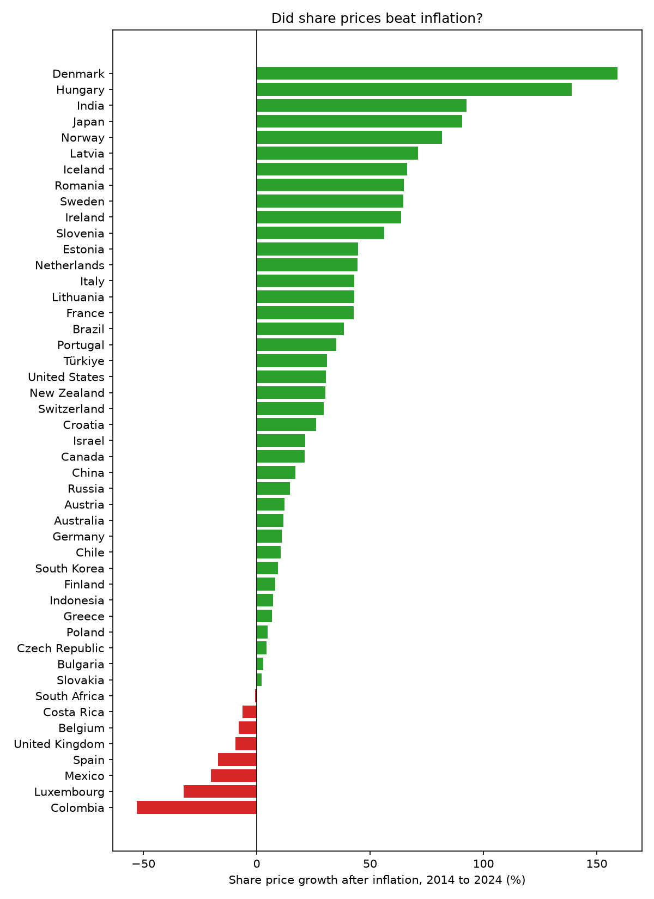

# Inflation and Stock Prices

*Data Wrangling through Analytics with Python* · ESMT Berlin, MAAI 2027 · Group 4 Pinot Nero

## The question

Between 2014 and 2024, did each country's share prices grow faster than its consumer prices? In other words, in which countries did
investors gain in real terms, and in which did inflation eat the gains?

The question covers the **47 countries** for which the OECD publishes a yearly share price index for all eleven years and the World Bank
publishes consumer price inflation for every year from 2015 to 2024: Australia, Austria, Belgium, Brazil, Bulgaria, Canada, Chile, China,
Colombia, Costa Rica, Croatia, Czech Republic, Denmark, Estonia, Finland, France, Germany, Greece, Hungary, Iceland, India, Indonesia,
Ireland, Israel, Italy, Japan, Latvia, Lithuania, Luxembourg, Mexico, Netherlands, New Zealand, Norway, Poland, Portugal, Romania, Russia,
Slovakia, Slovenia, South Africa, South Korea, Spain, Sweden, Switzerland, Türkiye, the United Kingdom and the United States.

## The answer

**Share prices beat inflation in 39 of the 47 countries between 2014 and 2024. The median real gain was 21%, from +159% in Denmark to
−53% in Colombia. In eight countries (Colombia, Luxembourg, Mexico, Spain, the United Kingdom, Belgium, Costa Rica and South Africa),
inflation ate more than the share price gains.**

"After inflation" means the growth of the share price index divided by the rise in consumer prices over the same ten years. The index
counts price changes only, not dividends, so the real return an investor got was higher than shown, especially in markets with high
dividends such as the United Kingdom. The figures are in each country's own currency, so they show what a local investor gained, not
what a foreign investor gained after exchange rates.

The numbers come from `notebooks/05_store_and_answer.ipynb`, and the per-country table is `data/processed/real_returns.parquet`.

## Sources

| source | link | what we used | terms of use |
|---|---|---|---|
| OECD Data Explorer | https://data-explorer.oecd.org (dataset *Financial market*, `DSD_STES@DF_FINMARK`) | yearly share price index per country (2015 = 100), 2014 to 2024 | OECD terms and conditions: free to use with attribution |
| World Bank Indicators API | https://api.worldbank.org/v2/country/all/indicator/FP.CPI.TOTL.ZG | inflation, consumer prices (annual %), 2014 to 2024 | CC BY 4.0 |
| Wikipedia | https://en.wikipedia.org/wiki/ISO_3166-1 | table of ISO 3166-1 country codes | CC BY-SA 4.0 |

All three are downloaded by `notebooks/01_acquire.ipynb`, through a session with retries, a timeout and a `User-Agent`. Nothing was
downloaded by hand. Every download is recorded in `data/raw/download_log.csv` with its URL, HTTP status, size and time.

## What's where

| | |
|---|---|
| `notebooks/` | one notebook for each stage, run in order: `01_acquire`, `02_clean`, `03_combine`, `04_validate`, `05_store_and_answer` |
| `data/raw/` | the files exactly as downloaded, and `download_log.csv` |
| `docs/cleaning_log.md` | what was wrong with each source and how we fixed it |
| `docs/corrections.csv` | every row removed or kept by a rule in `03_combine` or `04_validate`, with the reason |
| `data/processed/` | the final tables as Parquet, the chart, and `DATA_DICTIONARY.md`, which describes every column |

## How the data was checked

- **Before the merges** (`03_combine`), `assert`s check that the country codes have the same format in every table, that each key is
  unique where the merge expects it to be, and that every country with share prices has inflation data. Every merge uses `validate=`.
- **After the merges** (`04_validate`), rules written in code check for one row per country and year, all 11 years, complete
  inflation and plausible inflation, plus two rules that compare columns:
  - the World Bank's own two-letter country code must equal the ISO two-letter code on every row, so each country's inflation is joined
    to its own share prices;
  - a share index rise of more than 100% in a year is only accepted when inflation that year was above 10% (this flags Türkiye in 2023,
    which is kept, with the reason in `docs/corrections.csv`).

